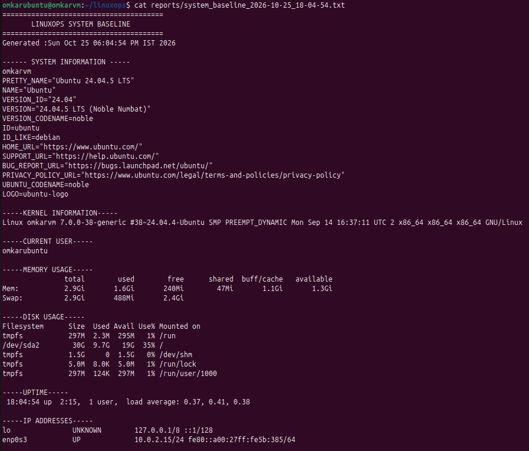
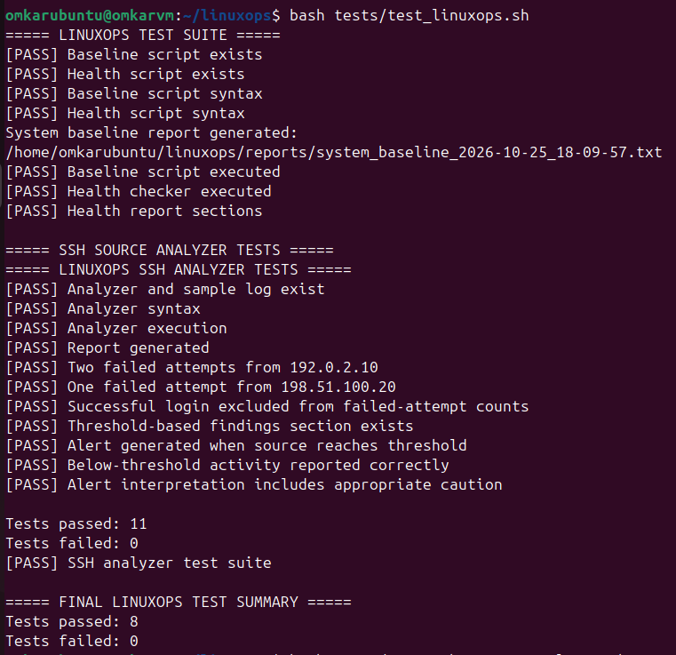
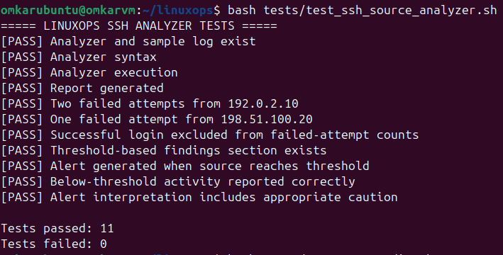
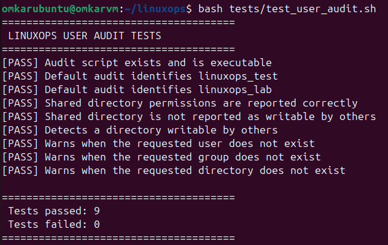
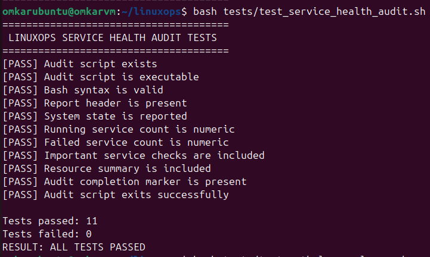
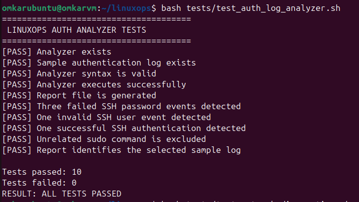
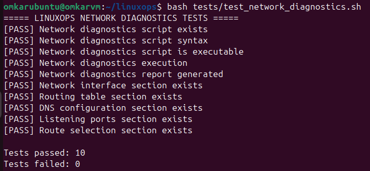
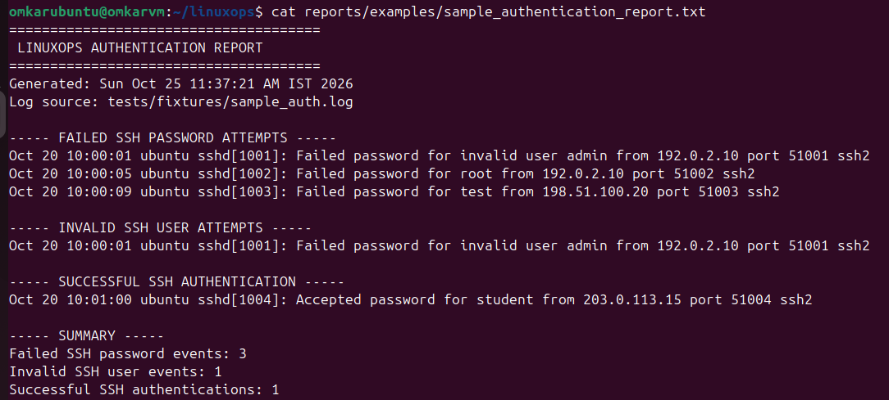
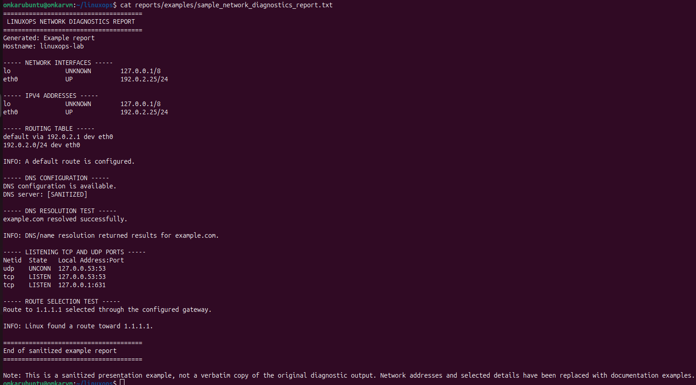

# LinuxOps — Linux Administration & Security Analysis Lab

A hands-on Linux portfolio project demonstrating Bash scripting, system administration, security log analysis, network troubleshooting, and automated testing in an Ubuntu environment.

## Project Overview

LinuxOps is a modular Linux administration and security analysis project developed in an Ubuntu virtual machine.

It uses Bash scripts to collect system information, assess basic system health, audit users and permissions, inspect service status, analyze SSH authentication logs, and troubleshoot network configuration.

The project emphasizes practical command-line skills, repeatable diagnostics, readable reports, and automated testing.

## Project Objectives

- Automate routine Linux administration checks.
- Collect system baseline and health information.
- Audit users, groups, and filesystem permissions.
- Inspect systemd services and selected system resources.
- Analyze SSH authentication events and failed login patterns.
- Examine network interfaces, routes, DNS configuration, and listening ports.
- Generate timestamped diagnostic reports.
- Validate script behavior using automated Bash test suites.
- Document findings and limitations clearly.

## Technology Stack

| Technology | Purpose |
|---|---|
| Ubuntu Linux | Development and testing environment |
| Oracle VirtualBox | Virtualized Linux lab |
| Bash | Automation and diagnostic scripts |
| Standard Linux utilities | System inspection, log analysis, and network diagnostics |
| Git | Version control |
| GitHub | Source code hosting and portfolio presentation |
| Bash test scripts | Automated functional and regression testing |

## Project Modules

### Module 01 — System Baseline & Health Checks

Collects system information and performs basic health checks.

**Capabilities**
- Hostname, operating system, and kernel information
- Current user and system uptime
- Memory and disk utilization
- Network interface information
- System load and failed-service checks
- Timestamped diagnostic reports

**Scripts**
- `scripts/system_baseline.sh`
- `scripts/system_health.sh`

### Module 02 — Users, Groups & Permissions

Audits user and group information and checks filesystem permissions.

**Capabilities**
- User and group inspection
- Directory ownership and permission checks
- Detection of potentially risky permission settings
- Warnings for missing users, groups, or paths

**Script**
- `scripts/user_audit.sh`

### Module 03 — Services & Process Management

Collects service and resource information to help assess basic system health.

**Capabilities**
- Systemd service-state inspection
- Running and failed service counts
- Checks for selected services when available
- Uptime, memory, swap, and root filesystem information

**Script**
- `scripts/service_health_audit.sh`

### Module 04 — Security Log Analysis

Analyzes SSH authentication events from a supplied log file or the system's default authentication log.

**Capabilities**
- Counts failed SSH password attempts
- Identifies matching invalid-user events
- Counts successful SSH authentications
- Groups failed SSH password attempts by source IP
- Flags repeated failures using a configurable-in-code threshold
- Generates timestamped reports

**Scripts**
- `scripts/auth_log_analyzer.sh`
- `scripts/ssh_source_analyzer.sh`

The project includes a synthetic authentication log fixture for repeatable testing.

**Important:** Repeated failures are indicators for investigation, not proof of an attack. Log availability and permissions affect the results.

### Module 05 — Network Troubleshooting

Collects basic network configuration and diagnostic information.

**Capabilities**
- Network interfaces and IPv4 addresses
- Routing table and default-route checks
- DNS configuration inspection
- Hostname resolution testing
- Listening TCP and UDP port inspection
- Route selection toward a public IP address
- Timestamped diagnostic reports

**Script**
- `scripts/network_diagnostics.sh`

A configured route or listening port does not, by itself, prove network reachability or establish that a service is vulnerable.

## Project Structure

```text
linuxops/
├── README.md
├── modules/
│   ├── 01-system-baseline/
│   ├── 02-users-permissions/
│   ├── 03-services-processes/
│   ├── 04-security-logs/
│   └── 05-network-troubleshooting/
├── scripts/
│   ├── system_baseline.sh
│   ├── system_health.sh
│   ├── user_audit.sh
│   ├── service_health_audit.sh
│   ├── auth_log_analyzer.sh
│   ├── ssh_source_analyzer.sh
│   └── network_diagnostics.sh
├── tests/
│   ├── fixtures/
│   │   └── sample_auth.log
│   ├── test_linuxops.sh
│   ├── test_ssh_source_analyzer.sh
│   ├── test_user_audit.sh
│   ├── test_service_health_audit.sh
│   ├── test_auth_log_analyzer.sh
│   └── test_network_diagnostics.sh
├── reports/
└── screenshots/
```

## Getting Started

### Prerequisites

- An Ubuntu Linux environment
- Bash
- Standard Linux diagnostic utilities
- Appropriate permissions to read the system information and logs being inspected

Some checks depend on utilities or services available on the host. The scripts may produce warnings when a command, service, or log source is unavailable.

### Clone the Repository

```bash
git clone https://github.com/Omkarharkulkar/LinuxOps.git
cd LinuxOps
```

### Run Diagnostic Scripts

Run scripts from the repository root:

```bash
bash scripts/system_baseline.sh
bash scripts/system_health.sh
bash scripts/user_audit.sh
bash scripts/service_health_audit.sh
bash scripts/auth_log_analyzer.sh
bash scripts/ssh_source_analyzer.sh
bash scripts/network_diagnostics.sh
```

The authentication and SSH source analyzers accept an optional log-file path. For example, to test them with the supplied fixture:

```bash
bash scripts/auth_log_analyzer.sh tests/fixtures/sample_auth.log
bash scripts/ssh_source_analyzer.sh tests/fixtures/sample_auth.log
```

Review each module's README for its specific behavior and usage notes.

## Automated Testing

LinuxOps includes six Bash test suites covering core functionality, script execution, report generation, log analysis, user and permission auditing, service auditing, and network diagnostics.

Run the complete test suite:

```bash
for test in \
    tests/test_linuxops.sh \
    tests/test_ssh_source_analyzer.sh \
    tests/test_user_audit.sh \
    tests/test_service_health_audit.sh \
    tests/test_auth_log_analyzer.sh \
    tests/test_network_diagnostics.sh
do
    echo
    echo "===== Running $test ====="
    bash "$test" || exit 1
done
```

**Latest local validation:** All six test suites passed in the development environment.

The tests validate the scenarios they cover; they do not guarantee behavior on every Linux distribution or system configuration.

## Reports

LinuxOps diagnostic scripts generate timestamped text reports under `reports/`.

Generated reports are ignored by Git by default because they may contain environment-specific information. Sanitized presentation examples are maintained in `reports/examples/`.

### Sample Reports

The repository includes the following sample reports to demonstrate the project's output:

- [System Baseline Report](reports/examples/sample_system_baseline_report.txt) — system information, memory usage, disk utilization, uptime, and network interfaces.
- [Authentication Analysis Report](reports/examples/sample_authentication_report.txt) — failed SSH password attempts, invalid-user attempts, and successful authentications from a sample log.
- [Network Diagnostics Report](reports/examples/sample_network_diagnostics_report.txt) — example network interfaces, routing, DNS, and listening-port information.

These examples are intended for demonstration and may be sanitized or reconstructed rather than verbatim copies of actual script output. Review generated reports for sensitive information before sharing them publicly.

## Screenshots & Evidence

The screenshots below demonstrate LinuxOps scripts, automated tests, and diagnostic reports.

### System Baseline



Shows system information and resource usage collected by the baseline script.

### Automated Test Results








Shows test output used to validate the project's diagnostic scripts.

### Authentication Log Analysis



Demonstrates analysis of sample SSH authentication events, including failed attempts and the summary.

### Network Diagnostics



Shows example network troubleshooting information, including interfaces, routing, DNS, and listening ports.

## Security & Scope

LinuxOps is a learning and portfolio project focused on defensive administration and basic diagnostics.

- It does not replace a production monitoring or SIEM platform.
- Authentication analysis depends on the supplied log source and matching patterns.
- IP addresses and repeated login failures require context before drawing security conclusions.
- Network diagnostics inspect configuration and selected resolution or routing behavior; they are not a complete connectivity or vulnerability assessment.
- Permission warnings identify settings for review rather than automatically proving exploitation risk.

## Skills Demonstrated

- Linux command-line administration
- Bash scripting and error handling
- File permissions, ownership, users, and groups
- Systemd service inspection
- Authentication log analysis
- Basic network troubleshooting
- Report generation
- Automated shell testing
- Git and GitHub workflow
- Technical documentation

## Repository

GitHub: https://github.com/Omkarharkulkar/LinuxOps

## Future Improvements

Potential future enhancements include:
- More test cases for missing commands and unusual log formats
- Structured report output for easier downstream analysis
- Additional log sources and detection scenarios
- Improved portability across Linux distributions
- Sample report screenshots and architecture documentation
